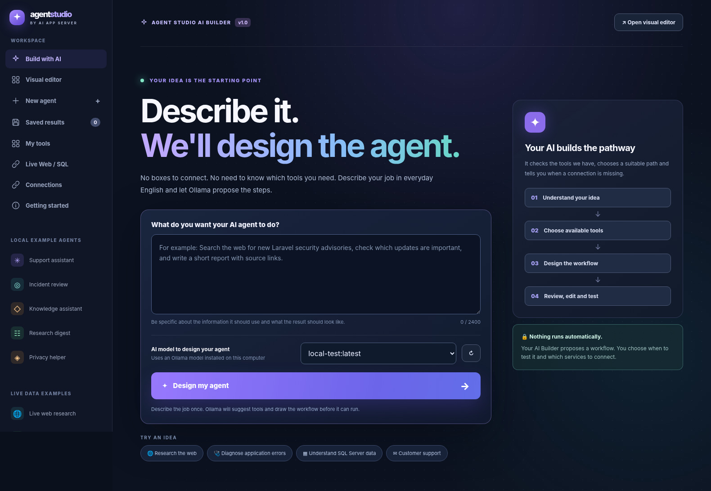
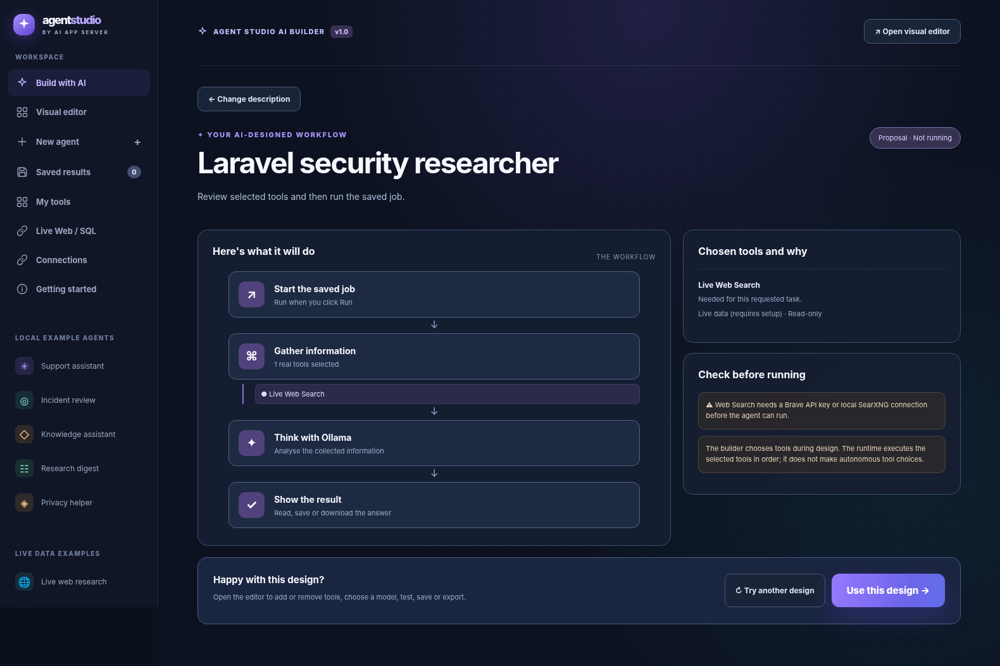
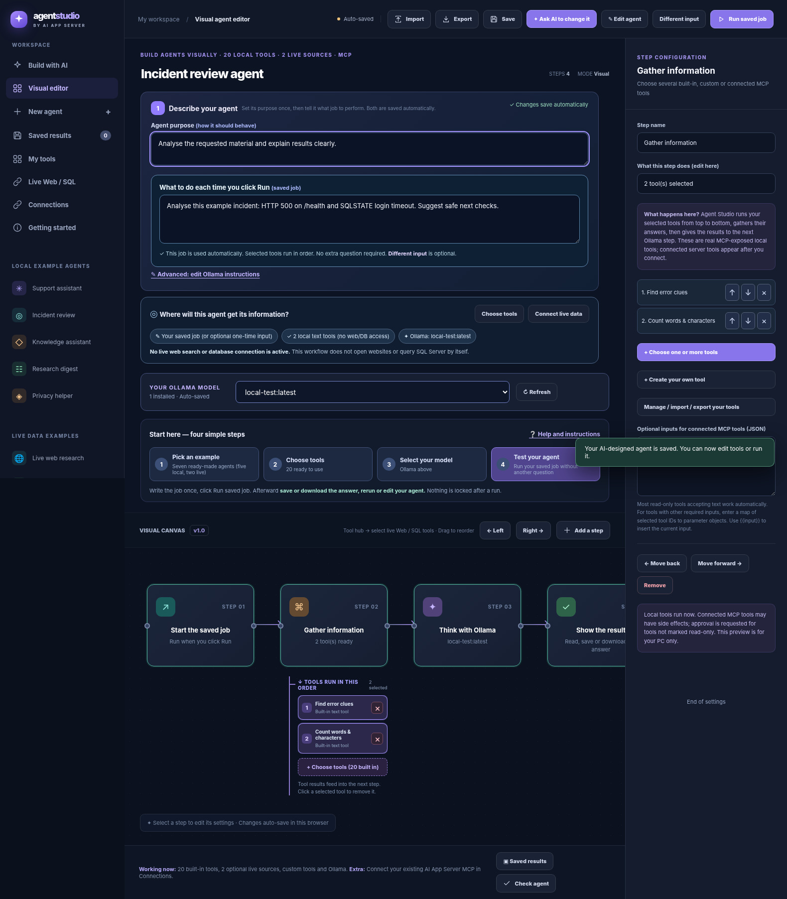
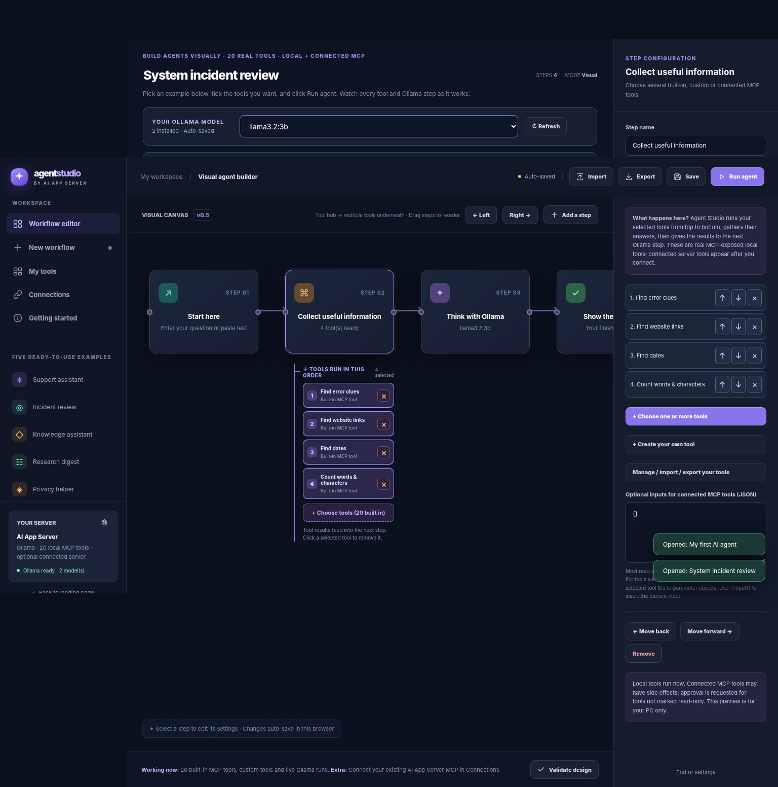
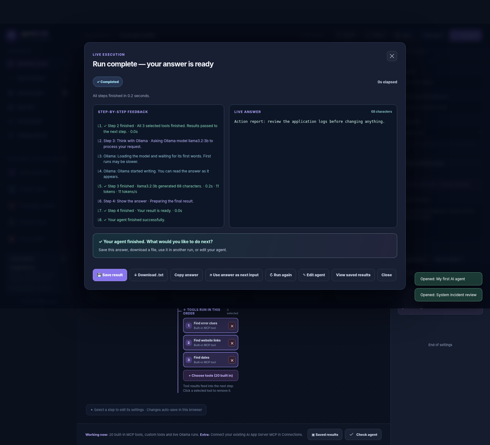

# AI Agent Studio

**Build your own AI agents by describing what you want in plain English.** Agent Studio proposes a workflow, lets you select or create tools, connects to local Ollama models, and runs inside the self-hosted [AI App Server](https://github.com/tuckbloor/AI-App-Server).

> **Release:** Agent Studio v2.2 · **Platform:** Windows development / self-hosted AI App Server · **Interface:** Original purple design
>
> **Project status:** Development build. Do not expose it directly to the public internet or deploy it to production without further security and operational testing.



The screenshots in this README are **real UI captures from earlier development versions** (with sample workflows and simulated run data). The current v2.2 interface and available controls may differ slightly; the images are not proof of a successful live installation or retailer search.

## What you can do

- **Describe an agent** in everyday language. Ollama suggests a plan using tools that actually exist.
- **Review and edit the workflow** before running it. Add, remove or reorder steps.
- **Choose tools** from 20 built-in text tools, key-free best-effort Web Search, read-only SQL Server, custom text/template tools and available MCP tools.
- **Run a saved job** without typing the same instructions again, with a step-by-step execution monitor.
- **Save results and export/import workflows** as JSON for another compatible Agent Studio installation.
- **Manage Studio through AI App Server**, using its administrator login and its native MCP endpoint when enabled.

## Install on Windows

### Before you start

- Windows 10/11 with **Python 3.11 or newer** available on `py` or `python`.
- An internet connection if `E:\ai-app-server` does not already exist; the installer retrieves the AI App Server source from GitHub.
- [Ollama](https://ollama.com/) installed and running if you want to design or execute an agent with a local AI model.
- The **complete Agent Studio v2.2 source package**, containing `INSTALL AND RUN.bat`, `INSTALL_AND_RUN.py`, `app/` and `tests/`.

### Installation steps

1. Close any running AI App Server terminal window. Port **8501** must be free before starting another server instance.
2. Extract the complete Agent Studio v2.2 ZIP directly to `E:\`. The resulting project folder should be:

   ```text
   E:\Agent-Studio-AI-App-Server-v2.2-COMPLETE\
       INSTALL AND RUN.bat
       INSTALL_AND_RUN.py
       app\
       tests\
       README.md
       images\
   ```

3. Double-click **`INSTALL AND RUN.bat`** in that folder.
4. The installer adds Studio to **`E:\ai-app-server`**. It backs up previous Studio source and verifies the required routes. It is designed to preserve the existing AI App Server engine, database, user accounts and configuration.
5. Wait for **`INSTALLED AND VERIFIED`**, then check that the integrated server starts. **Installation and server startup are separate checks**: a busy port can prevent startup even after installation has succeeded.
6. Visit the admin login first, then open the Agent Builder:

   | Page | Local address |
   | --- | --- |
   | Public homepage | `http://127.0.0.1:8501/` |
   | AI App Server admin | `http://127.0.0.1:8501/admin` |
   | Agent Builder / editor | `http://127.0.0.1:8501/admin/studio` |
   | MCP endpoint (when enabled) | `http://127.0.0.1:8501/mcp` |

**Important:** This README-and-images overlay is **not the installer**. It adds documentation and screenshots to the project folder. To install Studio, use the complete source package and its own `INSTALL AND RUN.bat`.

## Your first AI agent — step by step

### 1. Describe what you want

In the Agent Builder, choose your installed Ollama model, then enter a clear goal. For example:

> Find available super-king beds at Bensons for Beds. Check relevant retailer pages, find any clearly identified super-king prices, and return product names, prices and direct links. Explain when prices cannot be verified.

Click **Design my agent**. Studio asks Ollama to suggest a workflow; it does not run unreviewed tools at this stage.

### 2. Review the proposed workflow

Check that the suggested tools match the job. A request for current product prices needs **Live Web Search**, not a local number-extraction tool. Review any warnings about missing connections before accepting the design.



### 3. Edit the workflow

Click **Use this design** to open the visual editor. Change the agent purpose or saved task, edit instructions, add or remove tools, or rearrange steps. The model selector remains available in the editor.



### 4. Select several tools

A **Tool hub** can use multiple tools in the order you choose. Select from built-in tools or add a custom text/template tool. External MCP actions depend on the MCP server and its permissions; not every tool can act on a remote service.



### 5. Run, inspect and save

Click **Run saved job**. You do **not** need to type the same request again. The run monitor shows the step in progress, tools used, any search or database evidence, and Ollama's answer as it arrives. After the run, save the result, download it, rerun, or return to the editor.



## Web Search and SQL Server

**Web Search:** v2.2 tries known official retailer pages first when it can identify them, then uses public-search discovery as a fallback. It follows a limited number of relevant HTTPS links and anchor texts and tries to keep product names, prices and URLs together. It respects `robots.txt` and access restrictions. **It is not a guaranteed price-comparison service**: some shops block bots, render prices with JavaScript or show different prices by size and delivery option. It must report missing evidence instead of inventing prices.

**SQL Server:** Configure a database connection with an authorised **read-only** account. Use the table selector rather than free-form SQL; row and query limits apply. Do not use database administrator credentials for an agent.

**MCP tools:** Use the AI App Server administrator controls to enable MCP explicitly. Select only tools the agent is authorised to use. Do not include credentials in exported agents or commit them to GitHub.

## Saved work and sharing

- **Save** stores the workflow using the integrated Studio storage, with browser-side draft support.
- **Export** downloads workflow JSON that can be imported into another compatible Agent Studio installation.
- **Exporting JSON does not create a standalone Windows EXE or independently installable agent.** The recipient needs a compatible Agent Studio setup, an AI model and any required tool connections.
- Keep exported backups before clearing browser data or upgrading.

## Troubleshooting

| Problem | What to check |
| --- | --- |
| `WinError 10048` / port 8501 in use | Close the previous AI App Server process. Do not kill an unidentified process. |
| `404` on `/admin/studio` | Confirm the **integrated Agent Studio launcher** started and installer route verification succeeded. Sign in via `/admin` first. |
| No Ollama models in the dropdown | Start Ollama and run `ollama list` in PowerShell; refresh the Studio model list. |
| Web Search returns unrelated results or no prices | Try an exact retailer/product URL; see the run timeline. Some websites cannot be read automatically. |
| An agent uses the wrong tools | Return to the design review or editor and select Live Web Search or another appropriate tool before running. |
| Studio run stops | Use the run monitor's exact failing step and error details to diagnose the source, rather than assuming Ollama failed. |

## Run tests (developer use)

From the extracted complete project folder, with `pytest` installed in your environment:

```powershell
cd E:\Agent-Studio-AI-App-Server-v2.2-COMPLETE
py -m pytest -q
```

This tests the package's integration, installer and tool logic. Passing these tests does **not** replace acceptance testing against your own installed AI App Server, Ollama models and live websites.

## Publish to GitHub

Once the images and README are copied to your **Git repository root**, open PowerShell in that directory. If the repository already has `origin` configured, use:

```powershell
git add README.md images/
git commit -m "Add illustrated installation and usage guide"
git push origin main
```

If the folder has not yet been made into a Git repository, create the empty repository at `https://github.com/tuckbloor/AI-Agent-Studio`, then initialise and connect the local directory before pushing. Always review `git status` and use a `.gitignore` that excludes `.venv/`, credentials, local databases, data, backups, logs and generated reports.

## Project notes

Agent Studio is designed to run as an add-on to [AI App Server](https://github.com/tuckbloor/AI-App-Server). Each installed server should manage only its own applications, users, tools, configuration and data. The package includes its own licence and source code; see `LICENSE` in the complete distribution.
